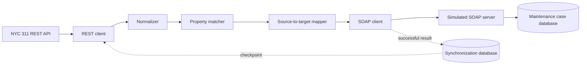

# CivicBridge 311 Integration

CivicBridge is a Python integration pipeline that turns live NYC 311 housing complaints into maintenance cases for a simulated property-management system.

The project demonstrates an end-to-end enterprise integration pattern: consume a REST/JSON source, normalize and match records, transform them into a canonical model, send SOAP/XML requests, persist destination state, and safely resume incremental processing after failures.

## What the integration does

1. Retrieves supported complaints from the NYC Open Data 311 API.
2. Normalizes source records into typed Python models.
3. Matches each complaint to a managed property by BBL or normalized address and borough.
4. Maps the complaint into a maintenance request with destination-specific category, priority, and status values.
5. Sends the request to a simulated SOAP destination.
6. Creates or updates the destination maintenance case in SQLite.
7. Records successful source records and integration-run history in a separate synchronization database.
8. Uses the last successful run as an incremental checkpoint on the next execution.

## Key capabilities

- Live REST integration with NYC Open Data
- SOAP 1.1 request and response handling
- Bounded pagination and deterministic source ordering
- Property matching by BBL with address-and-borough fallback
- Source-to-target value mapping and validation
- Idempotent create/update behavior
- SQLite persistence for destination cases and synchronization state
- Incremental checkpoints based on the last successful run
- Partial-failure safety: completed records remain recorded when a later record fails
- Timeouts and bounded exponential-backoff retries for REST and SOAP transport failures
- Structured lifecycle, record, and retry logging
- Automated unit and local integration tests

## Architecture



The two SQLite databases have separate responsibilities:

- `civicbridge_cases.db` represents the destination system and stores maintenance cases.
- `civicbridge_sync.db` stores synchronized source records and integration-run history.

## Processing flow

For each source complaint, the runner:

1. Rejects records already synchronized at the same or a newer source timestamp.
2. Attempts to match the complaint to the managed-property portfolio.
3. Skips unmatched complaints without sending them to the destination.
4. Maps matched complaints into a `MaintenanceRequest`.
5. Sends an `UpsertMaintenanceRequest` SOAP operation.
6. Records the returned `CREATED` or `UPDATED` result only after the destination succeeds.

If a run fails, its partial summary and error message are retained. The checkpoint advances only from a successful run, so a failed run cannot cause unprocessed source records to be lost.

## Source-to-target mapping

| NYC 311 source | Maintenance-case target | Rule |
|---|---|---|
| `unique_key` | `external_id` | Preserved as the idempotency key |
| Matched property | `property_id` | Match by BBL, then normalized address and borough |
| `complaint_type` | `category` | Converted through `CATEGORY_MAP` |
| `complaint_type` | `priority` | Converted through `PRIORITY_MAP` |
| `status` | `status` | Converted through `STATUS_MAP` |
| `complaint_type` + `descriptor` | `description` | Combined into a readable description |
| `created_date` | `reported_at` | Preserved as an ISO 8601 timestamp |
| Latest source activity timestamp | `source_updated_at` | Resolution update, closure, or creation timestamp |

Supported complaint mappings:

| NYC complaint type | Target category | Priority |
|---|---|---|
| `HEAT/HOT WATER` | `HEATING` | `HIGH` |
| `PLUMBING` | `PLUMBING` | `NORMAL` |
| `ELEVATOR` | `ELEVATOR` | `HIGH` |

Source statuses map from `Open` and `Closed` to `OPEN` and `CLOSED`.

## Design decision: idempotent upsert

The destination exposes one `UpsertMaintenanceRequest` SOAP operation instead of separate create and update operations. The NYC complaint `unique_key` is the destination's external key. A new key returns `CREATED`; an existing key is updated and returns `UPDATED`.

This keeps create/update selection inside the destination boundary, makes retries idempotent, and avoids a separate existence check between the integration and destination.

## Requirements

- Python 3.10 or newer
- Internet access for live NYC 311 requests
- No external database server

The only third-party runtime dependency is `requests`. SOAP/XML and SQLite support use the Python standard library.

## Installation

```bash
git clone <repository-url>
cd civicbridge_311_integration

python3 -m venv .venv
source .venv/bin/activate
python -m pip install -r requirements.txt
```

On Windows PowerShell, activate the environment with:

```powershell
.venv\Scripts\Activate.ps1
```

## Run the integration

Start the simulated SOAP destination in the first terminal:

```bash
source .venv/bin/activate
python -m src.civicbridge.soap_server
```

The server listens at `http://127.0.0.1:8000/soap` and creates `civicbridge_cases.db` when needed.

In a second terminal, run the integration:

```bash
source .venv/bin/activate
python -m src.civicbridge.runner
```

The default demonstration run:

- filters the live source to the first configured property's BBL;
- retrieves at most three pages of ten records;
- writes synchronization state to `civicbridge_sync.db`;
- prints a summary containing `fetched`, `unmatched`, `created`, `updated`, and `skipped` counts;
- emits structured logs for run lifecycle and record outcomes.

Stop the SOAP server with `Ctrl+C`.

## Run the tests

```bash
python -m unittest discover -s tests -v
```

The suite contains 55 tests covering:

- mapping and validation;
- property matching;
- REST queries, pagination, checkpoints, and retry behavior;
- SOAP envelope construction, faults, responses, and transport retries;
- destination create/update persistence across a server restart;
- synchronization state and integration-run history;
- deduplication, partial failure, recovery, and structured logging.

The intentional failure-path test logs a `SOAP unavailable` traceback while still passing. It verifies that a failed destination send is recorded and re-raised without marking the source record successful.

## Project structure

```text
src/civicbridge/
├── case_store.py       # Destination maintenance-case persistence
├── mapper.py           # Source-to-target field and value mapping
├── matcher.py          # BBL and normalized-address property matching
├── models.py           # Typed domain models
├── normalizer.py       # NYC 311 JSON normalization
├── nyc311_client.py    # REST queries, pagination, checkpoints, and retries
├── properties.py       # Synthetic managed-property portfolio
├── runner.py           # Integration orchestration and lifecycle logging
├── soap_client.py      # SOAP request, response, fault, and retry handling
├── soap_server.py      # Simulated destination endpoint
└── sync_store.py       # Deduplication, checkpoint, and run-state persistence

tests/                  # Unit and local integration tests
```

## Reliability behavior

- REST requests retry timeouts, connection failures, and selected transient HTTP statuses.
- SOAP requests retry transport timeouts and connection failures.
- Retries are limited to three attempts with exponential delays of 0.25 and 0.5 seconds.
- Permanent REST errors and SOAP faults fail immediately.
- A source record is marked successful only after the SOAP destination responds successfully.
- Run status is finalized as `SUCCEEDED` or `FAILED`, with counts and any error message persisted.
- Only successful runs provide future incremental checkpoints.

## Assumptions and limitations

- The property portfolio is intentionally small and defined in code for demonstration purposes.
- The SOAP service is a local simulation, not a production vendor or Workday endpoint.
- Authentication, TLS, secret management, and environment-specific configuration are out of scope.
- Processing is sequential rather than concurrent.
- Batches and pages are intentionally bounded.
- Offset-based pagination is appropriate for this demonstration but would need stronger consistency controls at higher scale.
- The integration supports a focused set of housing complaint types and source statuses.
- There is no scheduler or deployment automation; the pipeline runs from the command line.

## Possible production extensions

- Externalized configuration and secrets
- Authenticated HTTPS endpoints
- A formal WSDL and generated client bindings
- Cursor-based or snapshot-consistent pagination
- Dead-letter handling and operator-driven replay
- Metrics, tracing, and alerting
- Containerization, scheduling, and CI/CD
- A larger managed-property master-data source
